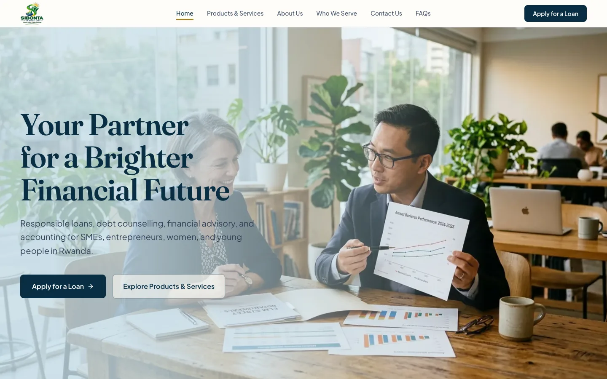
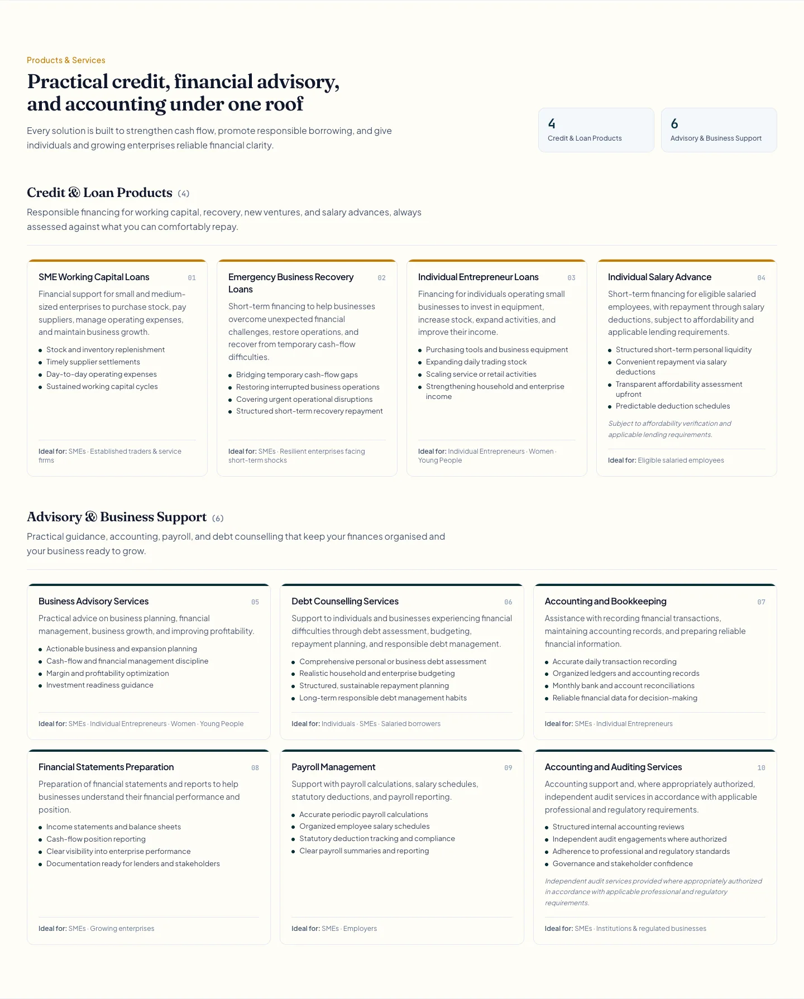
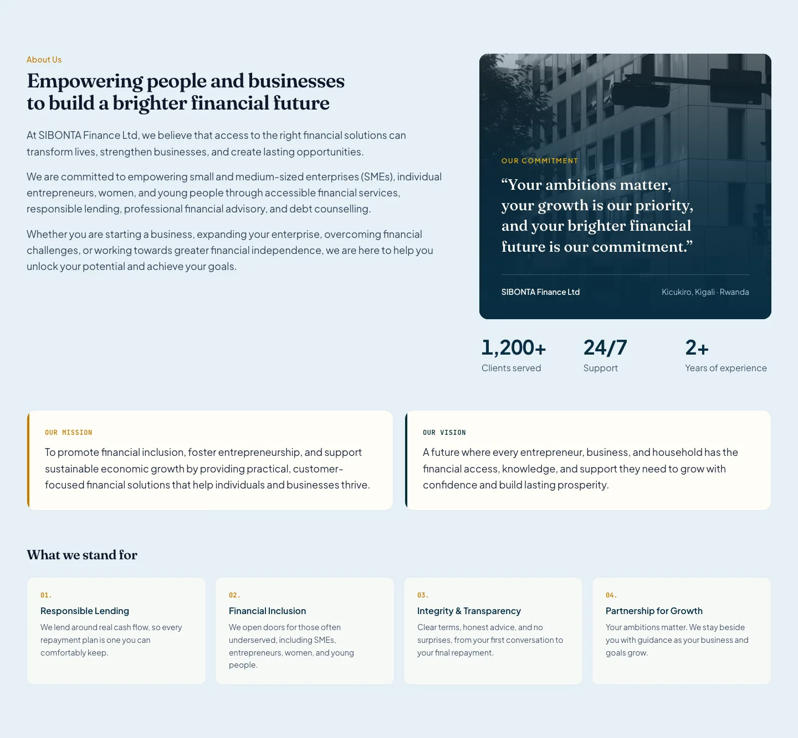
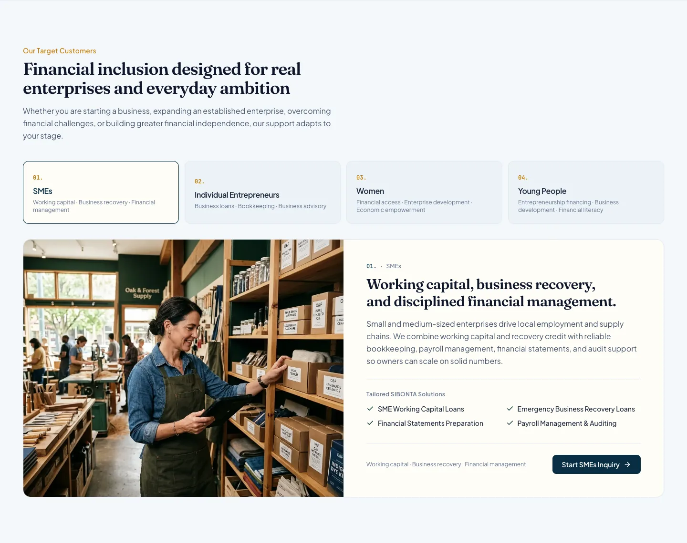
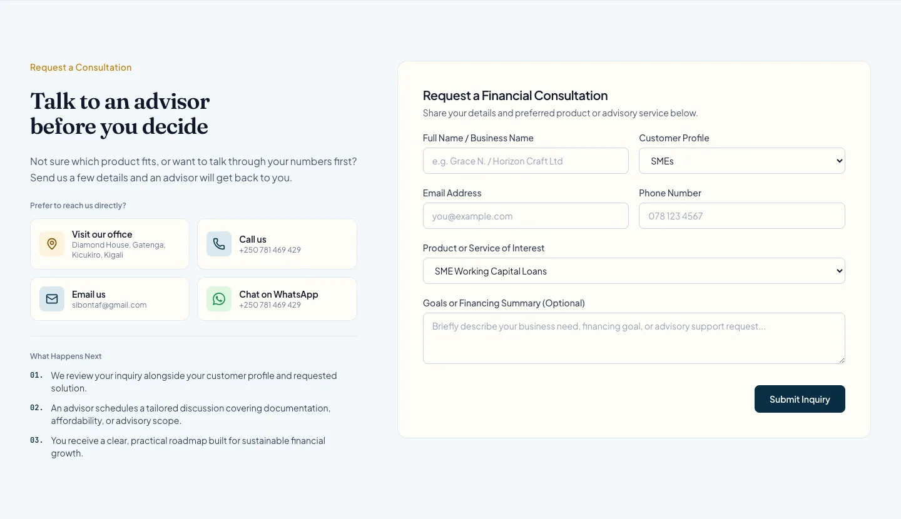
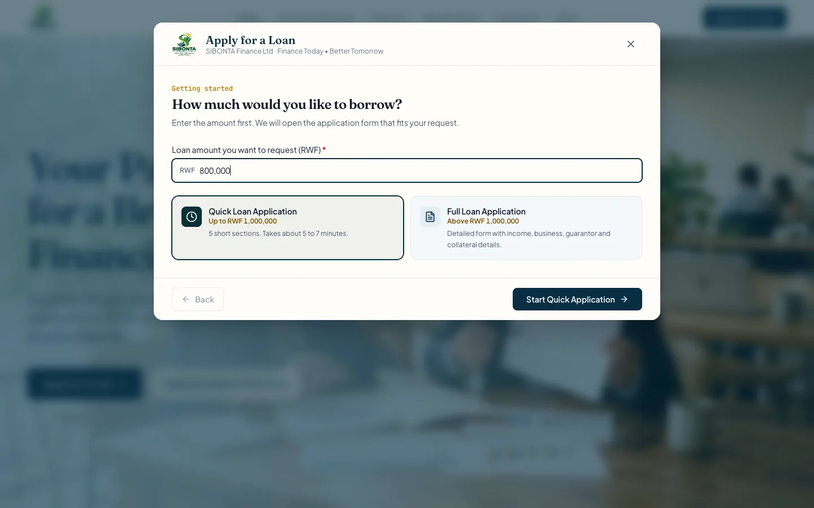
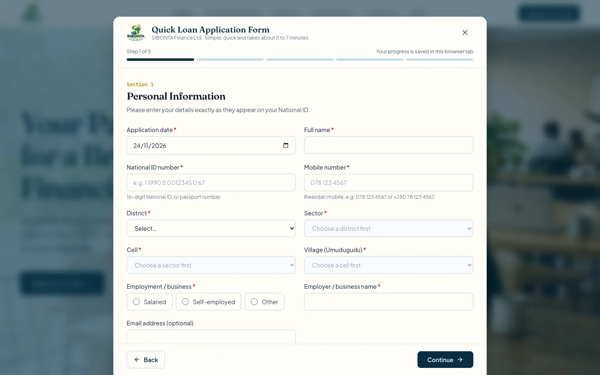
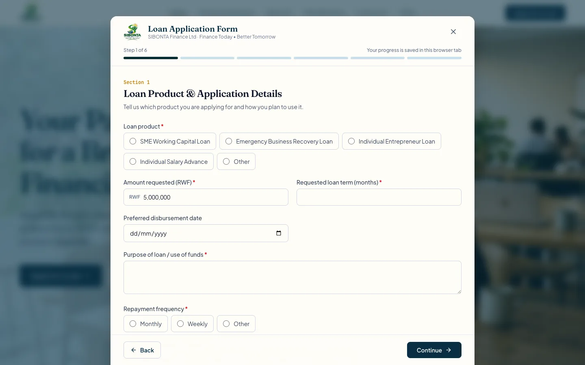
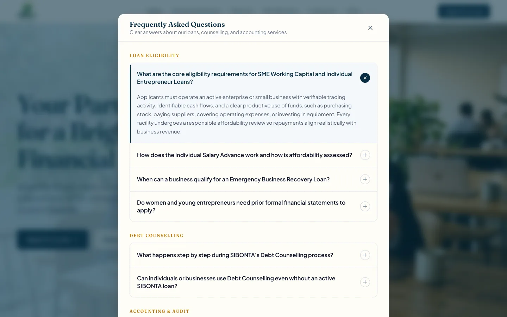
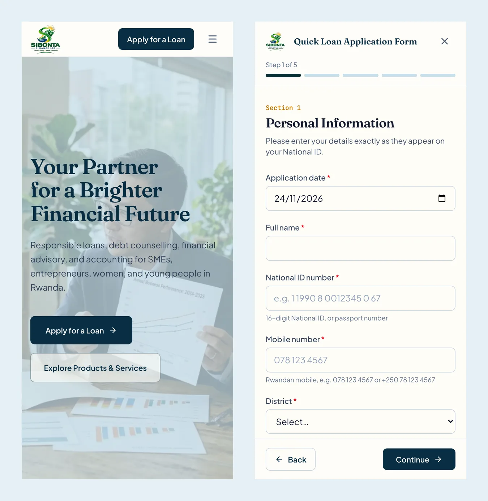

<div align="center">


# SIBONTA Finance Ltd

**Your Partner for a Brighter Financial Future**

Website for SIBONTA Finance Ltd, a financial services company in Kigali, Rwanda, offering responsible loans,
debt counselling, financial advisory and accounting to SMEs, entrepreneurs, women and young people.

**Live site:** [www.sibontafinance.com](https://www.sibontafinance.com)

</div>



---

## Contents

- [What the website does](#what-the-website-does)
- [Screenshots](#screenshots)
- [Tech stack](#tech-stack)
- [Run it on your computer](#run-it-on-your-computer)
- [How the forms send email](#how-the-forms-send-email)
- [Environment variables](#environment-variables)
- [Deployment](#deployment)
- [Common changes](#common-changes)
- [Project structure](#project-structure)
- [Credits](#credits)

---

## What the website does

| Section | What visitors can do |
|---|---|
| **Home** | Full-screen welcome with quick links to apply for a loan or browse services |
| **Products & Services** | Read about 4 credit products and 6 advisory and business support services |
| **About Us** | Read the company story, mission, vision, values and key figures (animated count-up) |
| **Who We Serve** | Pick a customer group (SMEs, Individual Entrepreneurs, Women, Young People) and see matching solutions |
| **Contact Us** | Send an enquiry, or reach the office by map, phone, email or WhatsApp |
| **FAQs** | Open a popup with answers about loans, debt counselling and accounting |
| **Apply for a Loan** | Apply online. The form is chosen automatically from the amount requested (see below) |

### Online loan application

The applicant first enters the amount they need:

| Amount requested | Form shown | Sections |
|---|---|---|
| **Up to RWF 1,000,000** | Quick Loan Application Form | 5: Personal Information, Loan Request, Financial Information, Repayment Information, Applicant's Declaration |
| **Above RWF 1,000,000** | Full Loan Application Form | Up to 7: Loan Product, Personal Details, Employment & Income, Business Details (business loans only), Existing Loans, Guarantor & Collateral, Documents & Declaration |

Both forms mirror the company's paper forms and include:

- **Rwandan data checks:** mobile numbers (078, 079, 072, 073), 16-digit National ID (checked against date of birth and gender), passport numbers, minimum age of 18.
- **Address dropdowns (quick form):** District → Sector → Cell → Village, covering all 30 districts, 416 sectors and 14,837 villages.
- **Saved progress:** answers are kept in the browser tab, so a refresh doesn't lose them.
- **Email delivery:** each application is emailed to the company inbox, and the applicant receives a confirmation (see [How the forms send email](#how-the-forms-send-email)).

---

## Screenshots

### Products & Services


### About Us


### Who We Serve


### Contact Us


### Loan application: choose the amount


### Quick Loan Application (up to RWF 1,000,000)


### Full Loan Application (above RWF 1,000,000)


### FAQs


### On a phone


---

## Tech stack

| Part | Tool |
|---|---|
| Interface | [React 19](https://react.dev) + TypeScript |
| Build | [Vite 8](https://vite.dev) |
| Styling | [Tailwind CSS v4](https://tailwindcss.com) |
| Animation | [Motion](https://motion.dev) (respects the device's "reduce motion" setting) |
| Icons | [Lucide](https://lucide.dev) |
| Hosting and server functions | [Vercel](https://vercel.com) |
| Email | [Brevo](https://www.brevo.com) transactional email API |
| Domain | `sibontafinance.com`, registered at Namecheap |

---

## Run it on your computer

You need [Node.js](https://nodejs.org) 20 or newer.

```bash
npm install        # install dependencies
npm run dev        # start the site at http://localhost:3000
npm run lint       # check TypeScript for errors
npm run build      # build the production site into dist/
npm run preview    # preview the production build at http://localhost:4173
```

`npm run dev` runs the website only. The email functions in `api/` run on Vercel, so locally the
forms will show a "couldn't send" message. To test them locally, use the [Vercel CLI](https://vercel.com/docs/cli)
(`vercel dev`) with the environment variables below.

---

## How the forms send email

```
Visitor fills a form ──► /api/loan-application or /api/enquiry (Vercel function)
                                   │
                                   ▼
                            Brevo email API
                           ┌───────┴────────┐
                           ▼                ▼
             Company inbox email    Confirmation email
             (all answers, reply    to the customer
              goes to customer)     (if they gave an email)
```

- The **Brevo API key is stored only in Vercel**. It is never in the code or sent to the browser.
- A hidden "honeypot" field quietly drops spam from bots.
- Emails use the company branding (logo, colours) and display well on phones.
- Every submission gets a reference number: `SIB-LA-xxxxxx` for loan applications, `SIB-xxxxxx` for enquiries.

---

## Environment variables

Set these in **Vercel → Project → Settings → Environment Variables**. Never commit them to GitHub.

| Variable | Required | Purpose |
|---|---|---|
| `BREVO_API_KEY` | ✅ | Brevo API key (Brevo → SMTP & API → API keys) |
| `BREVO_SENDER_EMAIL` | ✅ | Sender address, verified in Brevo |
| `BREVO_SENDER_NAME` | | Name shown as the sender. Default: `SIBONTA Finance Ltd` |
| `COMPANY_INBOX` | | Where applications and enquiries are delivered. Default: `sibontaf@gmail.com` |
| `SEND_CONFIRMATIONS` | | Set to `false` to stop confirmation emails to customers |
| `SITE_URL` | | Public site address used in emails. Default: `https://www.sibontafinance.com` |
| `EMAIL_LOGO_URL` | | Override the logo image used in emails |

> **Brevo security:** keep **"Blocking unauthorized IP addresses"** for API keys **turned off** in Brevo
> (Security → Authorized IPs). Vercel sends from changing IP addresses, so blocking them stops all emails.
> The current API key expires on **22 November 2027**. Create a new one and update `BREVO_API_KEY` before then.

---

## Deployment

Vercel deploys the site automatically:

1. Push to the `main` branch on GitHub.
2. Vercel builds and publishes it, usually within a minute.
3. The site updates at [www.sibontafinance.com](https://www.sibontafinance.com). The address without
   `www` redirects there, and the old `sibontatd.vercel.app` address still works.

**DNS (managed at Namecheap → Advanced DNS):**

| Type | Host | Value |
|---|---|---|
| A | `@` | `216.198.79.1` |
| CNAME | `www` | `4519893c97dd9fab.vercel-dns-017.com` |

Vercel renews the HTTPS certificate automatically. Keep **auto-renew** turned on for the domain at Namecheap.

---

## Common changes

| To change… | Edit |
|---|---|
| Phone, email, address, WhatsApp, map link | `COMPANY_CONTACT` in `src/data/sibontaData.ts` |
| About Us figures (clients served, support, years) | `COMPANY_STATS` in `src/data/sibontaData.ts` |
| Services, customer groups, FAQ questions | `src/data/sibontaData.ts` |
| Loan form questions and declarations | `src/components/loan-application/schema.ts` |
| Quick-loan limit (RWF 1,000,000) | `QUICK_LOAN_LIMIT` in `src/components/loan-application/schema.ts` |
| Phone and ID validation rules | `src/lib/validators.ts` |
| Email design and wording | `api/_lib/brevo.ts`, `api/loan-application.ts`, `api/enquiry.ts` |
| Photos | Replace the files in `public/images/`; paths are listed in `src/config/images.ts` |
| Show the Loan Planner (hidden) | Set `SHOW_LOAN_PLANNER = true` in `src/config/features.ts`. Its rates are placeholders, so update them with real RWF figures first |

---

## Project structure

```
├── api/                          Vercel server functions (email)
│   ├── _lib/brevo.ts             Brevo client and branded email layout
│   ├── enquiry.ts                Contact form → email
│   └── loan-application.ts       Loan applications → email
├── public/images/                Optimised WebP photos, logo, email logo
├── docs/screenshots/             Images used in this README
├── src/
│   ├── App.tsx                   Page layout and section order
│   ├── components/
│   │   ├── Navbar.tsx, Footer.tsx
│   │   ├── ServicesCatalog.tsx   Products & Services
│   │   ├── AboutSection.tsx      About Us
│   │   ├── TargetCustomersSection.tsx   Who We Serve
│   │   ├── ConsultationForm.tsx  Contact Us and enquiry form
│   │   ├── FaqDialog.tsx         FAQ popup
│   │   ├── loan-application/     Loan forms (schema, inputs, popup, submit)
│   │   ├── motion/               Reusable animations (reveal, count-up)
│   │   └── ui/Dialog.tsx         Reusable popup
│   ├── config/                   Feature flags and image paths
│   ├── data/                     Site content and Rwanda locations list
│   ├── lib/                      Validators, smooth scrolling, location lookup
│   └── index.css                 Tailwind theme (fonts and brand colours)
├── index.html                    Page title, social preview tags
└── vercel.json                   Caching rules
```

---

## Credits

- Rwanda's administrative locations (districts, sectors, cells, villages) come from the
  [`rwanda`](https://www.npmjs.com/package/rwanda) package by Igwaneza Bruce (MIT licence).
- © SIBONTA Finance Ltd. All rights reserved.
